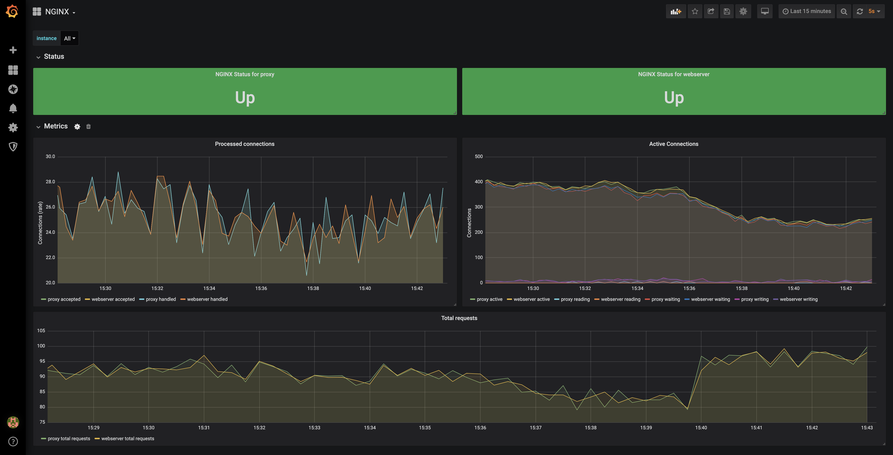

# Grafana Dashboard

We provide the official Grafana dashboard that visualizes the NGINX metrics exposed by the exporter. The dashboard
allows you to filter metrics per job and instance, or see the metrics from all of them.

<!-- START doctoc generated TOC please keep comment here to allow auto update -->
<!-- DON'T EDIT THIS SECTION, INSTEAD RE-RUN doctoc TO UPDATE -->
## Table of Contents

- [Prerequisites](#prerequisites)
- [Installing the Dashboard](#installing-the-dashboard)
- [Graphs](#graphs)

<!-- END doctoc generated TOC please keep comment here to allow auto update -->

## Prerequisites

The dashboard has been tested with the following software versions:

- NGINX Prometheus Exporter >= 0.4.1
- Grafana >= v9.0.0
- Prometheus >= v2.0.0

A Prometheus data source needs to be [added](https://prometheus.io/docs/visualization/grafana/#using) before installing
the dashboard.

## Installing the Dashboard

In the Grafana UI complete the following steps:

1. Use the *New Dashboard* button and click *Import*.
2. Upload `dashboard.json` or copy and paste the contents of the file in the textbox and click *Load*.
3. Set the Prometheus data source and click *Import*.
4. The dashboard will appear. Note how you can filter the job and instance labels just below the dashboard title
   (top left corner). This allows you to filter metrics per job and instance. By default, all values are selected.

## Graphs

The dashboard comes with 2 rows with the following graphs for NGINX metrics:

- Status
  - Up/Down status per instance. It shows the `nginx_up` metric.
- Metrics
  - Processed connections (`nginx_connections_accepted` and `nginx_connections_handled`). The panel shows the
    [rate](https://prometheus.io/docs/prometheus/latest/querying/functions/#rate) over the dashboard's
    `$__rate_interval`. Useful for seeing the variation of the processed connections in time.
  - Active connections (`nginx_connections_active`, `nginx_connections_reading`, `nginx_connections_waiting` and
    `nginx_connections_writing`). Useful for checking what is happening right now.
  - Total requests, as a rate of `nginx_http_requests_total` over time.

> **Note:** The OSS `stub_status` endpoint does not expose HTTP status codes, upstream server metrics or bytes.
> Use NGINX Plus or access logs if you need those metrics.
